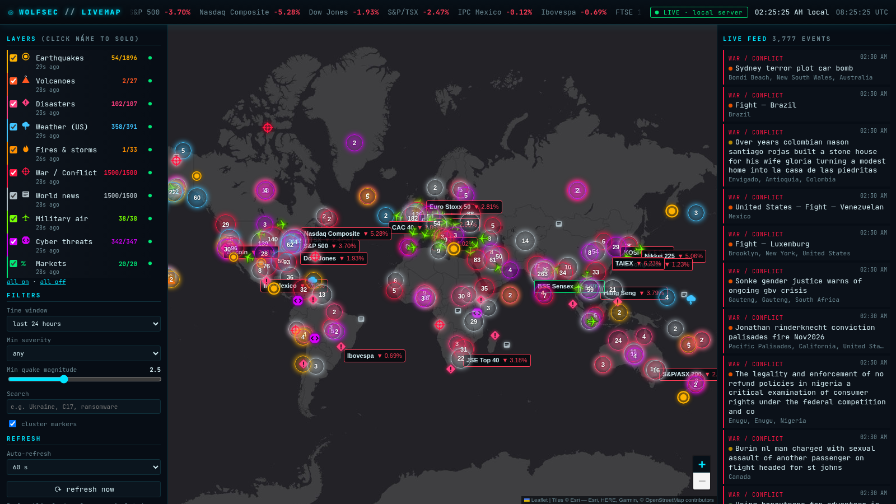
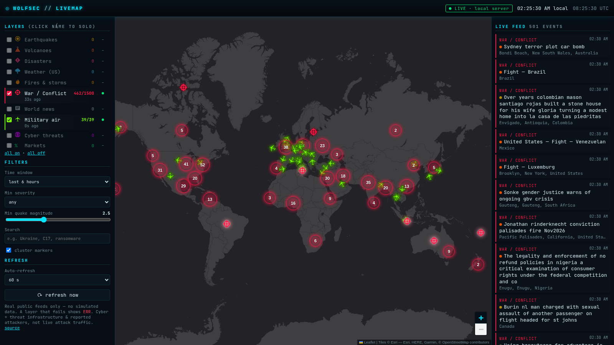
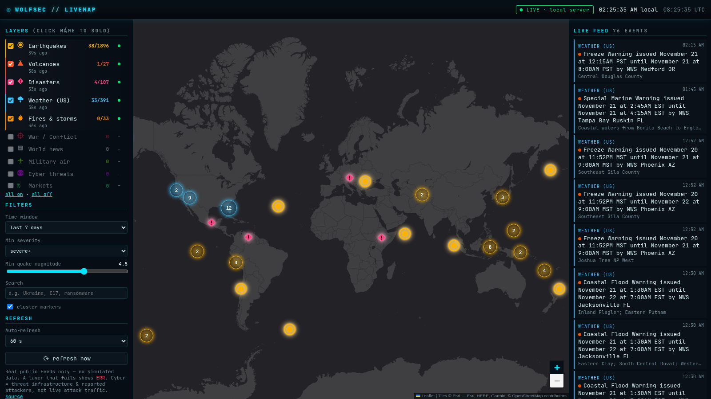
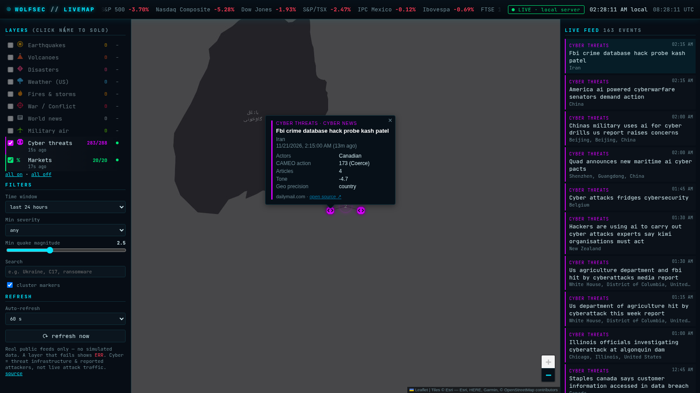

# WolfSec LiveMap 🌍

A dark, real-time world events map: **earthquakes, volcanoes, disasters, weather alerts,
wildfires & storms, war/conflict, world news, military aircraft, cyber threats and stock
markets**, all on one map with filters. It runs either as a small local Python app or as a
free static site on GitHub Pages.

**🔴 Live version:** **https://masterxhackerx420-oss.github.io/wolfsec-live-map/**



| Conflict + military, last 6 h | Severe hazards, last 7 days | Cyber layer popup |
|---|---|---|
|  |  |  |

## Features
- 10 toggleable layers, each with its own icon and colour. Click a layer **name** to show only that layer.
- Each layer shows its count (shown/total), status (● ok / `ERR` / `STALE`) and when it was last updated.
- Filters: **time window** (1 h / 6 h / 24 h / 7 d / any), **minimum severity**, **minimum quake magnitude**
  and **text search** (for example `Ukraine`, `C17`, `ransomware`).
- **Auto-refresh** (off / 30 s / 60 s / 2 min / 5 min) plus a manual refresh button.
- Marker clustering (can be turned off). Military aircraft icons point in their direction of travel.
- A **live feed** lists events newest first; click an item to fly to it on the map. A **markets ticker**
  runs across the top.
- Popups show the title, local time, location, details and a link to the original source.
- Settings are saved in your browser. You can share a filtered view with URL parameters, for example
  `?layers=conflict,military&window=6&sev=2&mag=4.5&q=ukraine`.
- **No fake data.** Every point comes from a real public feed. When a feed fails, its layer shows
  `ERR` (or `STALE`, keeping the last real data) and nothing is invented to fill the gap.

## Layers and sources (all free, no API keys)

| Layer | Source | Update | Pages mode |
|---|---|---|---|
| Earthquakes | [USGS GeoJSON feeds](https://earthquake.usgs.gov/earthquakes/feed/v1.0/geojson.php) (hour/day/week) | 1 min | 🟢 live in browser |
| Volcanoes | [Smithsonian GVP / USGS Weekly Volcanic Activity Report](https://volcano.si.edu/reports_weekly.cfm) + [USGS HANS](https://volcanoes.usgs.gov/hans-public/) elevated US volcanoes | weekly / as issued | 🟡 Actions snapshot |
| Disasters | [GDACS](https://www.gdacs.org) events API (earthquakes, cyclones, floods, volcanoes, droughts, wildfires) | ~5 min | 🟢 live in browser |
| Weather (US) | [NOAA/NWS active alerts](https://api.weather.gov/alerts/active), placed by polygon, county or zone | 2 min | 🟢 live in browser |
| Fires & storms | [NASA EONET v3](https://eonet.gsfc.nasa.gov) open events (icebergs left out) | 10 min | 🟢 live in browser |
| War / Conflict | [GDELT 2.0 Event Database](https://www.gdeltproject.org): CAMEO 15/18/19/20 (military posture, assault, fight, mass violence), rolling 24 h | 15 min | 🟡 Actions snapshot |
| World news | GDELT 2.0 events (all other CAMEO types), the most-covered stories from each 15-min batch | 15 min | 🟡 Actions snapshot |
| Military air | [adsb.lol](https://api.adsb.lol) `/v2/mil` (falls back to adsb.fi) | 30 s (server) | 🟡 Actions snapshot |
| Cyber threats | [SANS ISC DShield](https://isc.sans.edu) top attacking IPs, [abuse.ch Feodo Tracker](https://feodotracker.abuse.ch) botnet C2s, [ET compromised IPs](https://rules.emergingthreats.net/blockrules/), plus GDELT cyber-attack news; IPs located via ip-api.com / ipwho.is | 15 min | 🟡 Actions snapshot |
| Markets | Yahoo Finance chart API: 20 indices (S&P 500, Nasdaq, Dow, TSX, FTSE, DAX, CAC, Nikkei, Hang Seng, SSE, Sensex, ASX, …) + BTC, showing % change and open/closed | 2 min | 🟡 Actions snapshot |

🟢 = your browser fetches it straight from the source (always current).
🟡 = these sources block browser requests (CORS) or need server-side work (zip parsing, IP
geolocation), so a GitHub Action refreshes them every ~10 minutes. When you run the app
locally, **every** layer is fetched live by the Python server.

### Honest limits
- **Cyber threats are not live attack traffic.** No free source offers a real-time, geolocated feed
  of attacks as they happen, and the "attack maps" you see online are mostly animations. This layer shows
  real, current **malicious infrastructure and reported attackers**: botnet C2 servers, top scanning
  and attacking IPs, compromised hosts, and news reports of cyberattacks. IP geolocation is
  approximate (it often resolves to a city or the hosting company's datacentre).
- **GDELT is machine-coded from news articles.** Some events land on a country's centre point, and
  some get the wrong category (an "assault" story can be a court case). Headlines come from the
  article URL, and every popup links to the original article.
- **Military aircraft**: only planes that broadcast ADS-B/MLAT and appear in the community feed are
  shown, which leaves out most sensitive flights. On GitHub Pages positions can be up to about 10-15
  minutes old.
- **Weather alerts** cover the US only (NWS). Use the Disasters and Fires & storms layers for the rest of the world.
- **Markets** are delayed quotes (Yahoo Finance); in the static build they are about 10 minutes old.
- Rate limits: GDELT, ip-api.com (45 req/min, batch 15/min) and ipwho.is are free and rate-limited.
  The app caches every layer (each has its own TTL) and every IP lookup on disk to stay well under them.
- GitHub's scheduled runs can be late by several minutes, and GitHub pauses them after 60 days with no
  repository activity (re-enable them under the Actions tab).

## Install and run locally (all layers live)

The app is a small Python server (FastAPI) at **http://localhost:8765**. It needs Python 3.9 or newer
and an internet connection.

### Windows 10/11 (one click)
1. Download **`wolfsec-live-map.zip`** from [Releases](https://github.com/masterxhackerx420-oss/wolfsec-live-map/releases/latest) (or **Code → Download ZIP**), then unzip it. (Or `git clone https://github.com/masterxhackerx420-oss/wolfsec-live-map`.)
2. Double-click **`run_windows.bat`**.
   - If Python is missing, it offers to install Python 3.12 with `winget`, or opens python.org.
     When installing by hand, tick **"Add python.exe to PATH"**, then double-click the .bat again.
   - The first run creates a `.venv` folder and installs the dependencies (about 1 minute). Your browser then opens the map.
3. To stop the app, close the black console window.

### macOS / Linux
```bash
git clone https://github.com/masterxhackerx420-oss/wolfsec-live-map && cd wolfsec-live-map
bash run_mac_linux.sh          # PORT=9000 bash run_mac_linux.sh to use another port
```
If Python is missing: macOS uses [python.org](https://www.python.org/downloads/) or `brew install python`.
Debian/Ubuntu uses `sudo apt install python3 python3-venv`.

### Docker (any OS)
```bash
docker build -t livemap .
docker run --rm -p 8765:8765 livemap
# then open http://localhost:8765
```

### Manual
```bash
python -m venv .venv
.venv/bin/pip install -r requirements.txt      # Windows: .venv\Scripts\pip ...
.venv/bin/python -m livemap                    # env: LIVEMAP_PORT, LIVEMAP_HOST, LIVEMAP_OPEN_BROWSER=0
```

API: `GET /api/layers` lists the layers and their status. `GET /api/layer/<id>` returns a normalized
GeoJSON FeatureCollection; add `?force=1` to skip the cache.

## Publish the live version (GitHub Pages, free, no server)
1. Push this repo to GitHub (public).
2. Go to **Settings → Pages → Build and deployment → Source** and choose **GitHub Actions**.
3. Go to **Actions → "Update live data & deploy Pages" → Run workflow** for the first run. After that it runs
   every 10 minutes and on every push to `main`.
4. The site is at `https://masterxhackerx420-oss.github.io/wolfsec-live-map/`.

The workflow (`.github/workflows/update-data.yml`) runs `scripts/update_data.py`. That script reuses the
same Python fetchers as the local server to write `docs/data/<layer>.json`, then deploys `docs/`. The
GDELT 24-hour window and the IP-geolocation cache carry over between runs through the Actions cache.
By default the data snapshots are **not** committed, which keeps the git history small. To commit
them as well, set the repo variable `COMMIT_DATA=true`.

To test the static build locally:
```bash
python scripts/update_data.py         # fills docs/data/*.json
cd docs && python -m http.server 8800 # open http://localhost:8800
```

## Project layout
```
livemap/            Python package
  feeds.py          one fetcher per source -> normalized GeoJSON (shared schema)
  registry.py       layer list, per-layer TTL cache, error/stale handling
  geoip.py          ip-api.com batch + ipwho.is fallback, on-disk cache
  server.py         FastAPI: /api/* + serves docs/ as the UI
docs/               the web UI (Leaflet), also the GitHub Pages site
  js/layers.js      layer catalogue + in-browser fetchers for CORS-friendly feeds
  js/app.js         map, filters, clustering, feed, refresh logic
  data/             us_counties.json + us_zones.json (NWS alert placement); layer snapshots are generated
scripts/
  update_data.py    writes docs/data/*.json (used by GitHub Actions)
  build_geo_refs.py rebuilds the county/zone lookup tables (rarely needed)
  screenshot.py     headless screenshots (dev only, needs playwright)
run_windows.bat · run_mac_linux.sh · Dockerfile
```

Basemap: Esri Dark Gray Canvas (keyless, attribution shown). Built by **MasterX HackerX / WolfSec**. MIT licence.
